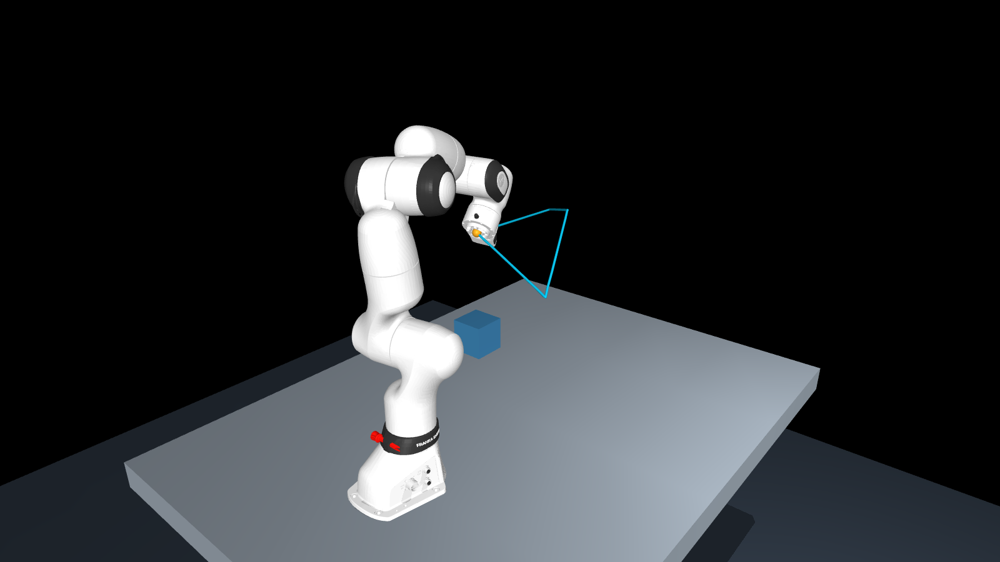
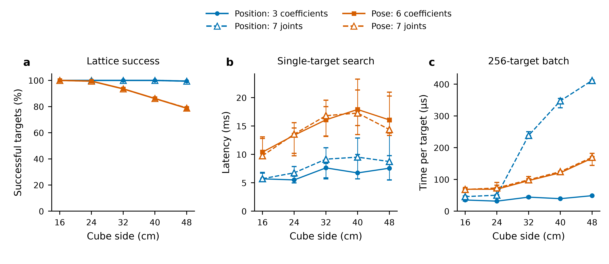

# MetaArm

**Victor's early exploration toward meta-learning a shared basis for robot arm motion and solving inverse kinematics in reduced coordinates.**

MetaArm investigates whether coordinated motion of a seven-joint arm can be represented by a learned basis, with each inverse kinematics (IK) query searching only its combination coefficients. The current work uses the Franka Research 3 in MuJoCo. Offline basis learning and online coefficient search provide the experimental foundation; meta-learning across tasks remains a research objective.



*MuJoCo rendering of a saved three-coefficient position-IK result in the 40 cm workspace study. Cyan traces the achieved tool positions along one held-out path; gold marks the displayed configuration. This is a kinematic reconstruction, not a physical tracking trial.*

## Learned motion, reduced search

For a reference configuration $q_{\mathrm{ref}}\in\mathbb{R}^{7}$, the learned motion directions form the columns of $\Phi_{\theta,k}(x)\in\mathbb{R}^{7\times k}$. IK searches the coefficients $\alpha\in\mathbb{R}^{k}$ through the affine reconstruction

$$
q(\alpha)=q_{\mathrm{ref}}+\Phi_{\theta,k}(x)\alpha,
\qquad q_{\min}\leq q(\alpha)\leq q_{\max}.
$$

Here, $\theta$ denotes offline learned weights, $x$ denotes the conditioning input, and $q_{\min},q_{\max}$ are joint limits. The reference and basis remain fixed during each solve. Six coefficients address position and orientation; three address nominal planar motion or regional position tasks with free orientation. The studies examine both a basis frozen along a trajectory and target-conditioned pose charts.

The central question is whether the reduced coordinates retain the task motion needed over a useful region. Fewer search variables alone establish neither task coverage nor a runtime advantage. See the [research brief](docs/research_brief.md) for the formulation and open theoretical questions.

## Preliminary simulation results



*Fixed-chart workspace study: 6,561 lattice queries per task and cube size, centered at (0.50, 0, 0.50) m. Success requires joint feasibility, at most 1 mm position error, and, for pose, at most 1° orientation error. Timing shows medians and interquartile ranges on an RTX 4070: 16 single targets with three repetitions and 256-target batches with five repetitions. Search timing excludes basis preparation; batch time per target measures throughput.*

Three-coefficient position IK succeeds on every sampled lattice query through the 40 cm cube. Six-coefficient pose IK reaches 78.74% at 48 cm, compared with 78.88% for seven-joint IK. Position search benefits from chart reuse; pose search has no consistent timing advantage in this study. The [study report](docs/workspace_expansion.md) and [comparison data](docs/figures/workspace_comparison.csv) give the protocol and measurements.

A [subsequent pose study](docs/pose_ik_improvement.md) adds neural initialization and three parallel affine charts. It recovers the nine additional 48 cm lattice queries solved by full-joint IK. Full-joint IK with the same neural initialization has similar query latency, indicating that initialization accounts for most of the measured timing gain.

These are sampled kinematic results. Continuous workspace coverage, collision avoidance, dynamic feasibility, and hardware performance remain unestablished.

## Running the experiments

The locked environment requires Python 3.12 and an NVIDIA GPU with CUDA support. From the repository root:

```powershell
uv sync --locked
uv run --locked python -m metaarm
```

Open the [local experiment UI](http://127.0.0.1:8080) to compare learned coefficients with full-joint IK for pose and plane targets. The UI requires the locally generated checkpoint named in `src/metaarm/gpu_ik.py`; checkpoints and raw experiment archives are excluded from Git. See [simulation setup](docs/simulation_setup.md) and [training](docs/neural_training.md) for preparation.

Collect motions, train a basis, and evaluate the configured checkpoint with:

```powershell
uv run --locked python -m metaarm.collection
uv run --locked python -m metaarm.training data
uv run --locked python -m metaarm.evaluation data
```

Regional experiments are documented in the [local workspace study](docs/local_workspace.md), [workspace expansion study](docs/workspace_expansion.md), and [pose study](docs/pose_ik_improvement.md). Robot assets retain the upstream [MuJoCo Menagerie provenance and license](assets/franka_fr3/SOURCE.md).
